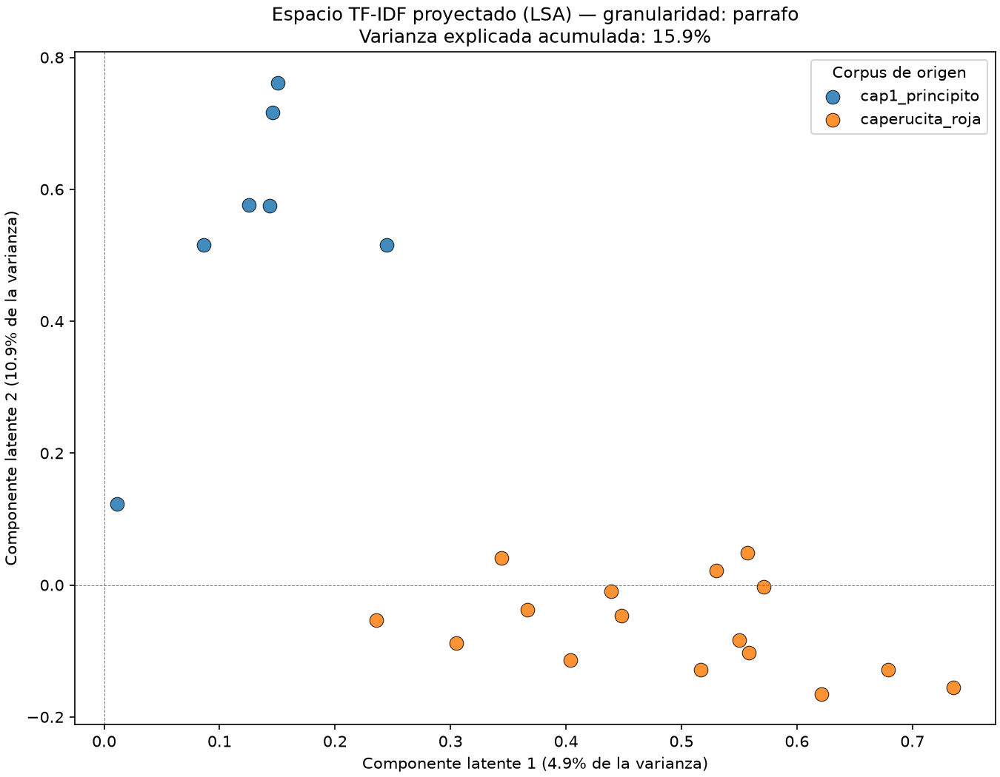
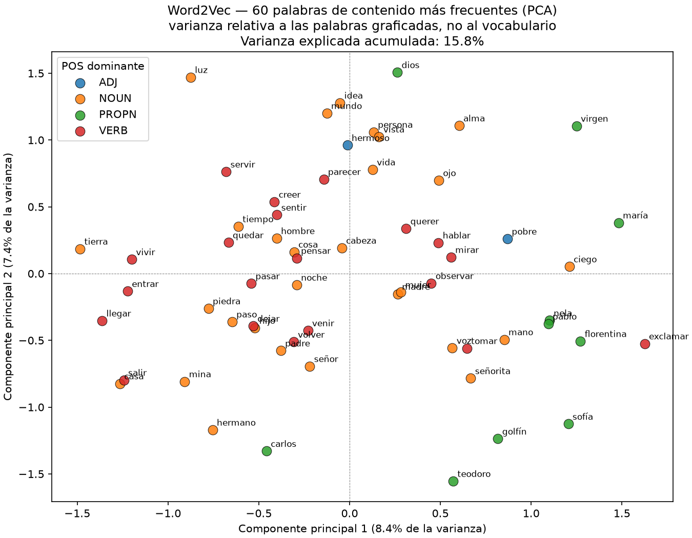
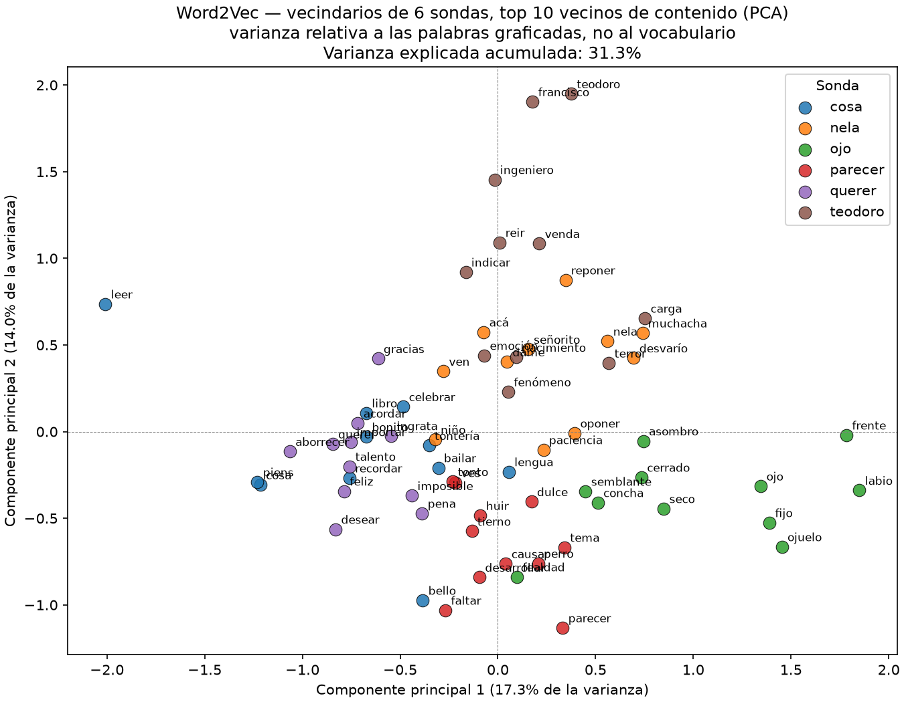

# nlp-text-normalization-spanish

Pipeline reproducible de **normalización, lematización, vectorización y embeddings de texto en español** con spaCy, scikit-learn y gensim, construido para evaluar empíricamente el efecto de cada etapa del preprocesamiento sobre el vocabulario resultante y sobre el espacio vectorial que se construye a partir de él.

El proyecto no se limita a ejecutar el pipeline: **mide** su efecto, **documenta** sus fallos y **verifica** con tests que las decisiones de diseño se cumplen.

Trabajo académico de la asignatura de Procesamiento de Lenguaje Natural — Ingeniería en Software, Hybridge Education.

---

## Tesis del proyecto

Un pipeline mal calibrado destruye información sin avisar. Este repositorio demuestra tres casos concretos con datos:

1. **El filtrado de stop words elimina los negadores**, y con ellos la polaridad de la oración. `"no falló"` y `"falló"` producen vectores idénticos.
2. **La compresión de vocabulario no mide la calidad de la normalización**, sino la redundancia léxica del corpus. Reportar un porcentaje sin la Type-Token Ratio que lo contextualiza es reportar un número sin significado.
3. **La granularidad del documento gobierna el comportamiento del IDF.** Vectorizar oración por oración hace que `df ≈ 1` para casi todo el vocabulario: el IDF pierde varianza y TF-IDF degenera en Bag-of-Words binario normalizado. La técnica no falla; queda desactivada por una decisión de segmentación que nadie declara.

---

## Arquitectura del pipeline

```
data/raw/*.txt
      │
      ▼
  carga.py ......................... I/O + saneamiento de encoding
      │
      ▼
  segmentacion.py .................. texto → lista de DOCUMENTOS (párrafos)
      │
      ▼
  normalizacion.py ................. tokenización, filtrado, lematización
      │
      ├──────────────► metricas.py ....... compresión, TTR, divergencia stem/lema
      │                                     (Etapa 1 — módulo 3)
      ▼
  vectorizacion.py ................. BoW + TF-IDF → matriz documento-término
      │                                     (Etapa 2 — módulo 4)
      ├──────────────► embeddings.py ..... Word2Vec → un vector denso por palabra
      │                                     (Etapa 3 — módulo 5)
      ▼
  visualizacion.py ................. TruncatedSVD (LSA) para documentos,
                                     PCA para embeddings → proyección 2D
```

La frontera entre etapas es la lista de tokens lematizados. Las Etapas 2 y 3 **no reimplementan** nada de la Etapa 1: consumen su salida. La Etapa 3 introduce una sola diferencia deliberada, que es conservar las stop words.

---

## Resultados — Etapa 1: normalización

Dos corpus procesados con el mismo pipeline y la misma configuración.

### Métricas generales

| | *El Principito*, cap. 1 | *Caperucita Roja* |
|---|---|---|
| Caracteres | 2,423 | 6,078 |
| Tokens totales (con puntuación y espacios) | 516 | 1,372 |
| Tokens útiles (sin puntuación ni espacios) | 422 | 1,089 |
| Tokens de contenido (tras filtrar stop words) | 166 | 434 |
| Filtrado sobre texto útil | 60.7 % | 60.1 % |
| Oraciones con contenido | 27 | 63 |

### Compresión de vocabulario

Las tres cifras se calculan sobre **el mismo conjunto de tokens** — los de contenido. Comparar formas sin filtrar contra lemas filtrados mezcla el efecto del filtrado con el de la normalización y produce una tabla inválida.

| Tratamiento | \|V\| Principito | Reducción | \|V\| Caperucita | Reducción |
|---|---|---|---|---|
| Sin normalizar | 129 | — | 265 | — |
| Stemming (Snowball) | 120 | 7.0 % | 239 | 9.8 % |
| Lematización (spaCy) | 125 | 3.1 % | 248 | 6.4 % |
| **Type-Token Ratio** | **0.777** | | **0.611** | |

**Interpretación.** La lematización comprime poco en ambos corpus, y no es un defecto del pipeline: con una TTR de 0.777, el 78 % de las palabras de contenido de *El Principito* aparecen una sola vez (*hapax legomena*). No hay variantes que fusionar. Al pasar a un corpus con más redundancia léxica —TTR 0.611— la compresión por lematización se duplica.

Esto sostiene la tesis de que **la lematización no es una técnica de compresión sino de generalización**. Su valor aparece frente a texto no visto: si el corpus de entrenamiento contiene `tragaba` y un documento nuevo dice `tragarán`, sin lematización son términos sin relación y el vector pierde la señal. Medir eso requiere cobertura *out-of-vocabulary* sobre un conjunto de prueba, no `|V|` sobre un solo texto.

### Efecto de preservar los negadores

| | Principito | Caperucita |
|---|---|---|
| Tokens de contenido, con negadores | 166 | 434 |
| Tokens de contenido, sin negadores | 161 | 406 |
| **Diferencia** | 5 (3.0 %) | **28 (6.5 %)** |
| \|V\| lematizado, con / sin | 125 / 122 | 248 / 243 |
| TTR, con / sin | 0.777 / — | 0.611 / 0.640 |

La lista de stop words de spaCy para español incluye `no`, `ni`, `nada`, `nunca`, `sin`, `tampoco`, `nadie` y `ningún`. En español la negación es una **partícula independiente sin redundancia morfológica**: nada más en la oración la recupera. Eliminarla no reduce ruido, invierte el significado.

Ejemplo tomado de *Caperucita Roja*. Oración original:

> «Había una vez una adorable niña que era querida por todo aquél que la conociera, pero sobre todo por su abuelita, y **no** quedaba **nada** que **no** hubiera hecho por la niña.»

Salida del pipeline en ambas configuraciones:

```
con negadores:  ['adorable','niña','querer','conociero','abuelita','no','quedar','nada','no','niña']
sin negadores:  ['adorable','niña','querer','conociero','abuelita',     'quedar',       'niña']
```

La construcción es una **doble negación** que en español afirma: la abuela hizo absolutamente todo por la niña. La versión filtrada deja `quedar` a secas y elimina una estructura lógica de dos niveles. Ningún modelo entrenado sobre esos vectores puede recuperarla, porque la información ya no está.

Reproducir el comportamiento por defecto del material de referencia:

```bash
python main.py --sin-negadores
```

---

## Resultados — Etapa 2: vectorización

### Diseño experimental

El corpus de vectorización se construye con **los párrafos de ambos textos en una sola matriz**, etiquetados por origen.

La alternativa —una oración por documento, un texto a la vez— produce `df ≈ 1` para casi todo el vocabulario: el IDF queda plano y TF-IDF se vuelve indistinguible de un BoW binario L2-normalizado. Con dos corpus de dominios léxicos disjuntos (*zorro / rosa / planeta* frente a *lobo / abuela / bosque*) el IDF sí tiene sobre qué discriminar.

Esto convierte el ejercicio en un experimento con **hipótesis falsable**:

> Si BoW y TF-IDF capturan contenido temático, los párrafos de cada texto deben separarse en el espacio proyectado.

Si no se separan, no es un resultado: es un defecto que hay que diagnosticar.

### Configuración del vectorizador

| Parámetro | Valor | Razón |
|---|---|---|
| `analyzer` | función identidad | Consume la lista de lemas de la Etapa 1 **sin re-tokenizar** |
| `lowercase` | `False` | La normalización ya ocurrió; repetirla es trabajo redundante y riesgo silencioso |
| `min_df` | `2` | Descarta *hapax legomena*, que por la ley de Zipf son cerca de la mitad del vocabulario |
| `max_df` | `0.90` | Elimina términos ubicuos — lo que el IDF de scikit-learn **no** hace (ver limitaciones) |
| `sublinear_tf` | `True` | `tf → 1 + log(tf)`; amortigua la distribución de Zipf dentro del documento |
| `norm` | `l2` | Filas en la esfera unitaria: habilita la similitud coseno y hace comparables documentos de distinta longitud |
| `smooth_idf` | `True` | Es el default; se declara explícitamente para documentar qué fórmula se está usando |

`min_df` y `max_df` son las dos perillas que controlan la dispersión (*sparsity*). El material de referencia describe el problema y no menciona ninguna de las dos.

### Métricas del espacio vectorial

> **Pendiente de ejecución.** Estas celdas se llenan con la salida real de `python main.py --vectorizar`. No se publican números estimados.

| Métrica | Valor |
|---|---|
| Documentos (párrafos) | ‹pendiente› |
| Documentos por corpus | ‹pendiente› / ‹pendiente› |
| Vocabulario \|V\| tras `min_df` / `max_df` | ‹pendiente› |
| Densidad de la matriz (celdas no nulas) | ‹pendiente› % |
| IDF — mínimo / máximo / desviación estándar | ‹pendiente› |
| Similitud coseno media, intra-corpus | ‹pendiente› |
| Similitud coseno media, inter-corpus | ‹pendiente› |
| Varianza explicada, 2 componentes | ‹pendiente› % |

**Criterio de lectura.** Si `idf_std` cae por debajo de ~0.25, el IDF no está discriminando y la segmentación en documentos es demasiado fina: la tabla no describe TF-IDF, describe BoW binario. Si la similitud intra-corpus no supera claramente a la inter-corpus, la vectorización no captó el tema y el gráfico no debe interpretarse.

### Términos más discriminantes

Peso TF-IDF medio por corpus. Es la lectura **interpretable** del modelo: se puede señalar exactamente qué término empujó cada decisión.

> **Pendiente de ejecución.** Se genera en `outputs/vectorizacion/terminos_discriminantes.csv`.

| Rango | *El Principito* | peso | *Caperucita Roja* | peso |
|---|---|---|---|---|
| 1 | ‹pendiente› | | ‹pendiente› | |
| 2 | ‹pendiente› | | ‹pendiente› | |
| 3 | ‹pendiente› | | ‹pendiente› | |

### Proyección del espacio vectorial



La reducción usa **`TruncatedSVD`**, no `PCA`, por tres razones acumulativas:

1. `PCA` centra los datos restando la media, lo que **densifica** la matriz dispersa y obliga a `.toarray()`. Sobre cualquier corpus de tamaño real eso termina en `MemoryError`; la documentación de scikit-learn recomienda `TruncatedSVD` explícitamente para matrices término-documento.
2. `PCA` sobre conteos crudos produce una primera componente que es esencialmente **longitud del documento**. El gráfico mostraría cuánto escribió el autor, no de qué escribió.
3. `TruncatedSVD` aplicado a una matriz TF-IDF **es** *Latent Semantic Analysis* (Deerwester et al., 1990). Las componentes latentes agrupan términos co-ocurrentes, con lo que dos sinónimos dejan de ser ortogonales. Es el único punto del pipeline que merece el adjetivo *semántico*.

La varianza explicada se imprime en el título del gráfico y no como nota al pie. Un scatter de dos componentes sobre un espacio de cientos de dimensiones puede representar una fracción pequeña de la información, y cualquier agrupamiento aparente puede ser artefacto de proyección. Sin ese número, la figura no es evidencia.

> **Nota (módulo 5).** Las cifras de esta sección se generaron con los dos corpus originales. Desde que *Marianela* está en `data/raw/`, `--vectorizar` sin `--corpus` la incluye: sus ~1 270 párrafos dominan la matriz frente a las decenas de los otros dos textos, y los resultados cambian. Las figuras y tablas del módulo 4 no se regeneraron.

---

## Resultados — Etapa 3: embeddings Word2Vec

### Diseño

Word2Vec aprende un vector denso por **palabra** a partir de los contextos en los que aparece (hipótesis distribucional). A diferencia de TF-IDF, dos palabras que nunca coinciden pero comparten contextos quedan cerca.

| Decisión | Valor | Razón |
|---|---|---|
| Corpus | los tres de `data/raw/` | *Marianela* aporta el 97 % de los tokens (50 759 de 52 258) |
| Unidad | lema, en minúsculas | con ~52 k tokens, la flexión del español repartiría las cuentas de cada palabra por debajo de `min_count` |
| Stop words | **no se filtran** al entrenar | la ventana de contexto necesita el texto íntegro; el submuestreo (`sample=1e-3`) degrada las palabras frecuentes sin borrarlas |
| Stop words | **sí se excluyen** al graficar | las palabras más frecuentes de una novela son palabras función (`el`: 3 992, `de`: 2 542, `que`: 1 847) y taparían el contenido |
| Troceo | por párrafo, con `nlp.pipe()` | los cortes caen en líneas en blanco, nunca a mitad de oración; un corte arbitrario inventaría un final de oración y el parser construiría un árbol falso |
| Algoritmo | skip-gram, 100 dim, ventana 5, `min_count=5`, 30 épocas | skip-gram aprende mejor las palabras poco frecuentes; un corpus chico necesita más épocas que el default de 5 |
| Reproducibilidad | `workers=1`, `seed=42`, `PYTHONHASHSEED=0` | ver abajo |

El libro tiene 293 991 caracteres, **por debajo** de `nlp.max_length` (1 000 000). Se trocea de todos modos: un `Doc` por párrafo acota el pico de memoria del parser, procesar en lote es más rápido y el código no cambia si mañana el corpus es diez veces más grande.

**Reproducibilidad.** gensim inicializa cada vector con `hash(palabra + semilla)`, y Python aleatoriza el hash de `str` en cada proceso. Fijar `seed` sin fijar `PYTHONHASHSEED` produce vectores distintos en cada corrida. Además, con varios hilos el orden de las actualizaciones depende del planificador del sistema operativo, así que la semilla no basta (documentación de gensim). `PYTHONHASHSEED` se lee al arrancar el intérprete y no puede fijarse desde el código; si falta, el pipeline lo advierte. Verificado: dos corridas con `PYTHONHASHSEED=0` producen vectores y texto procesado con SHA-256 idénticos.

### Diagnóstico de suficiencia

| Métrica | Valor |
|---|---|
| Tokens (con stop words) | 52 258 |
| Oraciones | 3 498 |
| Vocabulario (`min_count=5`) | 1 056 lemas |
| Cobertura (tokens dentro del vocabulario) | 85.9 % |
| Estabilidad de vecinos (Jaccard medio del top 10, semillas 42 vs. 43) | **0.445** |

**El corpus es insuficiente y el pipeline lo dice.** `most_similar` siempre devuelve diez vecinos con cuatro decimales, aunque sean ruido de la inicialización aleatoria; nada en su salida distingue señal de ruido. Por eso el diagnóstico reentrena con otra semilla y mide cuántos vecinos sobreviven: lo que pertenece al corpus sobrevive al cambio de semilla, y lo que pertenece a la inicialización no. Con un Jaccard medio de 0.445 (0.25 para `nela` y `parecer`, 0.67 para `ojo`), más de la mitad del top 10 cambia con la semilla. Las dos condiciones de aviso se cumplen:

```
[aviso] Corpus insuficiente: 52,258 tokens (umbral 100,000).
[aviso] Vecinos inestables: Jaccard medio 0.45 entre semillas 42 y 43 (umbral 0.5).
```

El umbral de 100 000 tokens es una heurística de este proyecto, no un estándar: el modelo original se entrenó con miles de millones.

### Proyección del espacio de embeddings





La reducción usa **`PCA`**, no `TruncatedSVD`, por la razón inversa a la de la Etapa 2. Allá la matriz es dispersa y centrarla la densificaría. Aquí ya es densa, y centrarla es **necesario**: los embeddings comparten un vector medio no nulo, y sin restarlo la primera componente apunta hacia esa media, que es común a todo el vocabulario y no distingue ninguna palabra de otra.

La varianza explicada va en el título y es relativa a las palabras graficadas, no al vocabulario completo: **15.8 %** para las 60 palabras más frecuentes y **31.3 %** para los vecindarios. La primera figura conserva menos de la sexta parte de la variación de esas 60 palabras, así que cualquier agrupamiento que muestre puede ser artefacto de la proyección. Lo más visible es una oposición sobre la componente 1: a la derecha, casi todos los personajes (`nela`, `pablo`, `florentina`, `sofía`, `teodoro`, `golfín`, `maría`) junto con vocabulario de diálogo y de cuerpo (`exclamar`, `voz`, `mano`, `ciego`); a la izquierda, desplazamiento y lugar (`llegar`, `entrar`, `salir`, `casa`, `tierra`, `mina`). `carlos` es la excepción y cae a la izquierda. Con 8.4 % de varianza en esa componente y la inestabilidad medida arriba, esto es una hipótesis que hay que comprobar sobre un corpus mayor, no un hallazgo.

---

## Limitaciones documentadas

Hallazgos observados durante el desarrollo. Se reportan porque son **sistemáticos y predecibles**, no ruido aleatorio.

### Lematizador (`es_core_news_sm` 3.8.0)

| Fenómeno | Ejemplos | Consecuencia |
|---|---|---|
| **Lemas inexistentes** | `conociera` → `conociero`; `criatura` → `criaturar` | Términos que no son palabras entran al vocabulario |
| **Masculinización de femeninos** | `caperuza` → `caperuzo`; `abuelita` → `abuelito`; `roja` → `rojo` | Sustantivos femeninos etiquetados como ADJ reciben lematización de adjetivo |
| **Inconsistencia intra-corpus** | `abuelita` → `{abuelita, abuelito}`; `criatura` → `{criatura, criaturar}` | La misma forma superficial recibe lemas distintos según el POS asignado en cada contexto: la normalización **divide** un término en vez de unificarlo |
| **Pretérito de 1ª persona** | `viví`, `dibujé`, `abandoné` sin transformar | Formas acentuadas de pretérito perfecto simple no se reducen al infinitivo |

El origen de la mayoría de estos casos es un **error de etiquetado POS** que se propaga al lema: el lematizador de reglas depende del POS tagger, así que una etiqueta equivocada produce un lema equivocado sin lanzar ninguna excepción.

Impacto sobre la Etapa 2: cada lema espurio es **un eje adicional** en el espacio vectorial. `abuelita` y `abuelito` ocupan dimensiones ortogonales, así que dos párrafos que hablan de lo mismo quedan más lejos de lo que deberían. El ruido del lematizador no se queda en la Etapa 1; se propaga a la geometría.

### Stemmer (Snowball / Porter2 español)

**Under-stemming en palabras cortas.** `años` → `años` y `ojos` → `ojos` conservan la marca de plural, mientras que `flores` → `flor` y `personas` → `person` sí se procesan. El patrón común de los fallos es la forma vocal–consonante–vocal–`s`: el algoritmo solo elimina sufijos que caen dentro de la región **RV**, calculada a partir de las primeras letras, y en ese patrón RV empieza demasiado tarde para alcanzar la `-s`.

### Sobre la tabla de divergencia

`sobre_stemming()` agrupa por stem y muestra los grupos con más de un lema. **Revela desacuerdo, no culpabilidad.** Un grupo puede originarse en over-stemming (el stemmer fusionó de más) o en un fallo del lematizador (no redujo lo que debía). En *El Principito*, 4 de 5 grupos correspondían a fallos del lematizador, no del stemmer.

Ninguna de las dos técnicas es *ground truth* por sí sola. Distinguir el origen de cada divergencia exige inspección manual.

### Embeddings

**Los errores del lematizador entran al vocabulario de Word2Vec.** `piens`, `señoritar` y `quier` aparecen entre los vecinos: son lemas inexistentes, el mismo fenómeno de la tabla anterior. Con lemas, cada error fragmenta los contextos de una palabra real en dos entradas.

**El doble guion ASCII fragmentaba el vocabulario.** *Marianela* transcribe la raya de diálogo como `--`, pegada a la palabra (`--¿Y tú?--dijo`). spaCy no lo separa, así que `nela--`, `--nela` y `nela` entraban como tres palabras distintas; el primer entrenamiento mostraba `nela-- (0.6062)` como vecino más cercano de `nela`. `carga.py` normaliza `--` a ` — ` con espacios, porque spaCy tampoco separa una raya pegada por ambos lados.

### Vectorización

**El IDF de scikit-learn no anula los términos ubicuos.** Con `smooth_idf=True` (el valor por defecto) la fórmula implementada es

```
idf(t) = ln[ (1 + n) / (1 + df(t)) ] + 1
```

y no la formulación clásica `log(N / df)`. El `+1` fuera del logaritmo implica que un término presente en **todos** los documentos recibe `idf = 1.0`, no `0.0`: conserva peso y su TF-IDF sigue siendo proporcional a su frecuencia. La intuición de que «el IDF limpia solo las palabras ubicuas» es falsa en esta implementación, y por eso el pipeline sigue necesitando el filtrado de stop words de la Etapa 1 más un `max_df` explícito. El comportamiento está codificado en `test_idf_de_termino_ubicuo_es_uno_no_cero`.

**Los vectorizadores de scikit-learn re-tokenizan por defecto.** `CountVectorizer` y `TfidfVectorizer` aplican `token_pattern=r"(?u)\b\w\w+\b"` y `lowercase=True` sobre la cadena que reciben. Entregarles el resultado de la Etapa 1 con `" ".join(lemas)` descarta todo token de un solo carácter y parte los lemas con guion, anulando en silencio el criterio lingüístico del módulo anterior. El pipeline pasa la lista de tokens con un `analyzer` de identidad, y el test `test_no_hay_re_tokenizacion` lo verifica.

**BoW no puede representar el alcance de la negación.** Preservar el negador lo mantiene como término del vocabulario, pero la bolsa de palabras no tiene forma de ligarlo a lo que niega: `"no falló"` y `"falló no"` producen el mismo vector. La Etapa 1 evita **perder** la partícula; representarla exige al menos `ngram_range=(1, 2)`, que capturaría el bigrama `no_fallar`. Está fuera del alcance de este entregable y queda documentado como extensión, no como resuelto.

**Los corpus son demasiado pequeños para el régimen donde TF-IDF brilla.** Dos textos de 2.4 KB y 6.1 KB producen un puñado de párrafos. Los resultados sirven para demostrar el mecanismo y validar la implementación con tests; no para sostener afirmaciones sobre el desempeño de la técnica. Un corpus adecuado tendría cientos de documentos.

**El espacio es léxico, no semántico** (en las Etapas 1 y 2). BoW y TF-IDF asignan a cada término un eje ortogonal, así que dos sinónimos perfectos son tan distintos entre sí como dos palabras sin relación. La proyección con `TruncatedSVD` mitiga esto parcialmente, y solo en la medida en que el corpus contenga suficiente co-ocurrencia. El nombre habitual de estas representaciones —*modelos semánticos*— describe la aspiración, no el mecanismo.

---

## Estructura

```
.
├── main.py                        # orquestador / CLI — punto de entrada único
├── data/
│   ├── raw/                       # corpus de entrada (inmutable: solo lectura)
│   └── processed/                 # artefactos derivados
├── src/
│   ├── config.py                  # decisiones de diseño, centralizadas
│   ├── carga.py                   # I/O + saneamiento de encoding
│   ├── normalizacion.py           # filtrado, lematización, segmentación en oraciones
│   ├── segmentacion.py            # texto → documentos (párrafos, con fallback)
│   ├── metricas.py                # compresión, TTR, divergencia stem/lema
│   ├── vectorizacion.py           # BoW, TF-IDF, similitud coseno, términos top
│   ├── embeddings.py              # Word2Vec, diagnóstico de suficiencia
│   └── visualizacion.py           # TruncatedSVD (LSA) / PCA + figura
├── tests/
│   ├── test_cli.py                # humo: CLI, imports, entorno
│   ├── test_normalizacion.py
│   ├── test_vectorizacion.py
│   └── test_embeddings.py
├── data/processed/
│   └── corpus_embeddings.txt      # entrada exacta de Word2Vec (versionada)
├── docs/                          # figuras referenciadas por este README (versionadas)
│   ├── proyeccion_lsa_{oracion,parrafo}.png
│   └── embeddings_{frecuentes,vecindarios}.png
├── outputs/                       # tablas CSV y modelo Word2Vec (no versionados)
├── requirements.txt               # dependencias directas (intención)
├── requirements.lock.txt          # árbol completo resuelto (estado)
└── .python-version                # intérprete fijado vía pyenv
```

**Separación config / invocación.** `config.py` contiene los parámetros que definen el comportamiento del sistema (modelo, negadores preservados, componentes desactivados, umbrales `min_df` / `max_df`); se versionan porque cambian el resultado. La ruta del corpus es un parámetro de **invocación**, no de diseño, y por eso vive en la CLI: procesar otro texto no debe requerir editar código fuente.

**Separación `outputs/` / `docs/`.** `outputs/` guarda artefactos derivados y regenerables, y no se versiona. `docs/` guarda las figuras que este README referencia: son documentación, no salida de proceso, y sí se versionan. Un README con una imagen rota es un README roto.

**Por qué `segmentacion.py` es un módulo aparte.** `normalizacion.py` segmenta en **oraciones**, que es una operación lingüística que depende del parser de spaCy. `segmentacion.py` decide qué constituye un **documento**, que es una decisión de diseño experimental con efecto directo sobre el IDF. Mezclarlas escondería la decisión más consecuente de la Etapa 2 dentro de un módulo cuyo nombre no la anuncia.

---

## Requisitos

- Python 3.12.12 (fijado en `.python-version`, gestionado con [pyenv](https://github.com/pyenv/pyenv))
- spaCy 3.8.16 · es_core_news_sm 3.8.0 · NLTK 3.9.1 · scikit-learn 1.5.2 · pandas 2.2.3 · matplotlib · gensim 4.4.0 · pytest 8.3.3

### Instalación

```bash
git clone git@github.com:BENMP0902/nlp-text-normalization-spanish.git
cd nlp-text-normalization-spanish

python -m venv .venv
source .venv/bin/activate          # Windows: .\.venv\Scripts\Activate.ps1

pip install -r requirements.txt
python -m spacy validate           # verifica compatibilidad modelo ↔ librería
pytest                             # esperado: 35 passed
```

El modelo se instala **fijado por URL del release**, no con `spacy download` en tiempo de ejecución. Descargar en runtime rompe cualquier build sin salida a internet (contenedor, CI) e instala una versión no fijada.

`matplotlib` se configura con el backend `Agg` dentro de `visualizacion.py`. El pipeline **escribe archivos, no abre ventanas**: funciona igual en WSL sin servidor X, en un contenedor y en CI.

---

## Uso

### Etapa 1 — normalización

```bash
python main.py                                        # corpus por defecto
python main.py --corpus caperucita_roja.txt           # otro corpus de data/raw/
python main.py --corpus /ruta/absoluta/texto.txt      # ruta completa
python main.py --corpus mi_texto.txt --guardar        # exporta CSV a outputs/<corpus>/
python main.py --sin-negadores                        # filtra también los negadores
python main.py --sin-filtro                           # sin filtrado de stop words
```

### Etapa 2 — vectorización

```bash
python main.py --vectorizar                           # ambos corpus de data/raw/
python main.py --vectorizar --corpus a.txt --corpus b.txt   # corpus explícitos
python main.py --vectorizar --guardar                 # exporta CSV + figura
```

| Bandera | Efecto |
|---|---|
| `--corpus RUTA` | Texto a procesar. Un nombre suelto se busca en `data/raw/`. Repetible en modo `--vectorizar`. |
| `--guardar` | Escribe `compresion.csv`, `stem_vs_lema.csv` y `over_stemming.csv` en `outputs/<nombre_corpus>/`; en modo `--vectorizar`, además `terminos_discriminantes.csv`, `similitud.csv` y la figura en `docs/` |
| `--sin-negadores` | Desactiva la preservación de negadores |
| `--sin-filtro` | Desactiva por completo el filtrado de stop words |
| `--vectorizar` | Ejecuta la Etapa 2 sobre todos los corpus indicados |

### Etapa 3 — embeddings

```bash
PYTHONHASHSEED=0 python main.py --embeddings            # los corpus de data/raw/
PYTHONHASHSEED=0 python main.py --embeddings --guardar  # modelo, texto procesado y figuras
```

Con `--guardar` escribe el modelo en `outputs/embeddings/word2vec.model`, el texto procesado en `data/processed/corpus_embeddings.txt` (una oración por línea, lemas separados por espacio: formato `LineSentence` de gensim) y las dos figuras en `docs/`. `--embeddings` y `--vectorizar` son excluyentes: cada etapa se invoca en su propia corrida.

Con `--granularidad bloque`, los archivos de la Etapa 2 llevan N en el nombre (`proyeccion_lsa_bloque4.png`): corridas con distinto `--oraciones-por-bloque` ya no se sobrescriben.

La Etapa 2 requiere **al menos dos corpus** o un corpus con suficientes párrafos. Con un solo documento el IDF es indefinido y el pipeline aborta con un mensaje explícito en lugar de producir una matriz sin significado.

---

## Agregar tus propios corpus

El pipeline está parametrizado: **no hay que tocar código para procesar un texto nuevo.**

```bash
# 1. Coloca el .txt en data/raw/ (la barra final evita renombrados accidentales)
cp /ruta/a/tu_texto.txt data/raw/

# 2. Ejecuta la Etapa 1
python main.py --corpus tu_texto.txt --guardar

# 3. Compara contra la configuración del material de referencia
python main.py --corpus tu_texto.txt --sin-negadores

# 4. Incorpóralo al espacio vectorial
python main.py --vectorizar --guardar
```

Si el archivo no existe, el error lista los corpus disponibles en `data/raw/` en lugar de fallar con un `FileNotFoundError` sin contexto.

### Requisitos del texto

| Criterio | Razón |
|---|---|
| **UTF-8, sin doble codificación** | `carga.py` aborta si detecta secuencias `Ã`, `Â`, `â€` — firma de mojibake. Repara el archivo en origen, no en el pipeline. |
| **Español contemporáneo** | `es_core_news_sm` se entrenó sobre AnCora. Con español del Siglo de Oro el POS tagger degrada de forma medible. |
| **Prosa, no verso** | La segmentación en oraciones usa el parser sintáctico; el verso libre rompe `doc.sents`. |
| **Párrafos separados por línea en blanco** | Es la señal que usa `segmentacion.py` para delimitar documentos. Si el `.txt` viene con líneas duras cada 80 columnas, el módulo cae al modo de bloques de oraciones y lo advierte por consola. |
| **Menos de 1,000,000 caracteres** | Límite de `nlp.max_length`. El pipeline falla con instrucción explícita si se supera; para textos mayores, procesar por capítulos con `nlp.pipe()`. |
| **Más de 100 KB, idealmente** | Con textos cortos la TTR se acerca a 1.0, ninguna técnica de normalización comprime de forma apreciable y el IDF se queda sin varianza. |
| **Derechos de autor verificados** | Ver la sección siguiente. |

Cada corpus escribe sus resultados en su propio subdirectorio de `outputs/`, así que las corridas no se sobreescriben y el nombre del directorio documenta con qué dato se generó cada tabla.

### Interpretar tus resultados

- **TTR alta (> 0.7)** → corpus corto o muy variado; una reducción baja es esperada, no un fallo.
- **Filtrado > 70 %** → revisa si el texto es una adaptación pedagógica o un material con densidad anómala de partículas gramaticales.
- **Divergencia stem/lema** → inspecciona los grupos a mano antes de atribuir la culpa a una técnica.
- **`no_ascii` cercano a 0** en un texto en español → los acentos se perdieron en algún paso previo.
- **`idf_std` < 0.25** → los documentos son demasiado cortos o demasiado pocos; TF-IDF está operando como BoW binario.
- **Densidad de la matriz < 1 %** → dispersión extrema; sube `min_df` o agrega corpus antes de interpretar distancias.
- **Varianza explicada baja en 2 componentes** → el gráfico representa una fracción pequeña de la información; los agrupamientos visibles pueden ser artefacto de proyección.

---

## Procedencia de los corpus

Documentar el origen de cada dato es parte del trabajo. Dos textos visualmente idénticos pueden tener propiedades distintas, y descubrirlo tarde invalida el análisis.

| Archivo | Obra | Nota |
|---|---|---|
| `cap1_principito.txt` | *El Principito*, cap. 1 — Antoine de Saint-Exupéry, traducción de Bonifacio del Carril | Incluido en el repositorio por requisito de la actividad evaluada. **No es de dominio público en México**: la ley federal establece vida del autor más 100 años, y Saint-Exupéry falleció en 1944. Se incluye un solo capítulo, con fines exclusivamente académicos y sin ánimo de lucro. |
| `marianela.txt` | *Marianela* — Benito Pérez Galdós (Imprenta y Litografía de La Guirnalda, Madrid, 1878) | **Dominio público**: Galdós falleció en 1920, y la ley mexicana (vida del autor más 100 años) lo libera desde 2021. Novela completa (293 991 caracteres, 22 capítulos), sin encabezado ni pie de licencia. Transcribe la raya de diálogo como `--` ASCII, normalizado en `carga.py`. |
| `caperucita_roja.txt` | *Caperucita Roja* — relato folclórico | El relato carece de autor con derechos vigentes, pero la traducción o adaptación concreta puede tener derechos propios. *Completar con la fuente exacta utilizada.* |

Durante el desarrollo, una versión previa del corpus resultó ser una **adaptación pedagógica para estudiantes de español como segunda lengua**, no la traducción canónica. Su densidad anómala de pronombres explícitos y muletillas habría distorsionado todas las métricas. Pasó todas las verificaciones técnicas —UTF-8 válido, sin mojibake, tamaño suficiente— y solo la inspección del contenido lo detectó.

**Criterio general:** el código se versiona; los datos se referencian. `data/raw/*.txt` está excluido por defecto en `.gitignore`, con una excepción explícita y documentada para el corpus del entregable. En producción, un corpus vive en almacenamiento de objetos con un puntero versionado (DVC, git-lfs), no dentro del repositorio.

---

## Tests

```bash
pytest -v
```

### Etapa 1 — `tests/test_normalizacion.py`

| Test | Qué verifica |
|---|---|
| `test_limpiar_lema_descarta_clitico` | Los pronombres enclíticos se eliminan del lema del verbo |
| `test_la_negacion_sobrevive_al_filtrado` | `"no falló"` y `"falló"` producen listas de lemas distintas |
| `test_reproduce_el_fallo_del_curso` | Con `PRESERVAR_NEGADORES=False`, ambas frases colapsan al mismo resultado |
| `test_ningun_lema_contiene_espacios` | Ningún lema queda como cadena multipalabra |
| `test_no_quedan_signos_de_puntuacion` | El filtrado elimina la puntuación |
| `test_el_lematizador_transforma_algo` | La lista de transformaciones no viene vacía (detecta modo `lookup`) |

### Etapa 2 — `tests/test_vectorizacion.py`

| Test | Qué verifica |
|---|---|
| `test_idf_de_termino_ubicuo_es_uno_no_cero` | Con `smooth_idf=True`, un término presente en todos los documentos recibe `idf = 1.0` |
| `test_max_df_si_elimina_el_termino_ubicuo` | `max_df` hace lo que la intuición atribuye erróneamente al IDF |
| `test_no_hay_re_tokenizacion` | Tokens de un carácter y lemas con guion sobreviven al vectorizador |
| `test_filas_tfidf_normalizadas_l2` | Cada documento queda sobre la esfera unitaria |
| `test_similitud_diagonal_unitaria` | La matriz de similitud coseno tiene diagonal 1.0 |
| `test_segmentacion_descarta_fragmentos_cortos` | Títulos y líneas sueltas no entran como documentos |

### Etapa 3 — `tests/test_embeddings.py`

| Test | Qué verifica |
|---|---|
| `test_entrenamiento_conserva_stop_words` | El corpus de Word2Vec conserva `el`, `de` y `no`; la puntuación sí se descarta |
| `test_construir_corpus_sin_argumento_conserva_comportamiento_previo` | Las Etapas 1 y 2 siguen filtrando stop words |
| `test_troceo_por_parrafo_no_parte_oraciones` | Cada parte termina en un final de oración real; un salto de línea simple no corta |
| `test_raya_ascii_se_separa_de_la_palabra` | `--Nela--` produce el lema `nela`, sin guiones pegados |
| `test_misma_semilla_da_vectores_identicos` | Con `workers=1`, la misma semilla da vectores idénticos, y otra semilla no |
| `test_corpus_minimo_dispara_aviso` | Un corpus diminuto produce el aviso de insuficiencia |
| `test_pca_centra_la_matriz` | La proyección tiene media cero aunque los vectores compartan un offset |

`tests/test_cli.py` cubre además que el CLI arranque, que cada módulo de `src/` importe (se descubren solos), que `requirements.txt` coincida con el entorno y que `--granularidad bloque` produzca nombres de archivo distintos para cada N.

`test_reproduce_el_fallo_del_curso` **codifica el defecto como comportamiento esperado** bajo una configuración explícita. Si algún día empieza a fallar, significa que la lista de stop words de spaCy cambió — y el aviso llega por el test, no por resultados anómalos varios módulos después.

`test_idf_de_termino_ubicuo_es_uno_no_cero` cumple la misma función frente a scikit-learn: convierte una nota al pie de la documentación en una aserción ejecutable. Si una versión futura cambiara la fórmula por defecto, el test avisa antes de que las métricas se muevan sin explicación.

---

## Decisiones de diseño

| Decisión | Razón |
|---|---|
| `data/raw/` inmutable | Ningún proceso escribe ahí. Un bug que sobreescriba el corpus original es irrecuperable. |
| Modelo fijado por URL del wheel | `spacy download` en runtime rompe builds sin red e instala versiones no fijadas. |
| Lematizar **antes** de bajar a minúsculas | El POS tagger usa la señal de mayúscula, y el lematizador de reglas depende del POS. El orden inverso degrada los lemas en silencio, sin excepción. |
| Doble verificación de stop words (forma y lema) | Una conjugación puede pasar el filtro de forma superficial y lematizarse a un lema que sí estaba en la lista. |
| `parser` activo | `doc.sents` lo requiere para la segmentación en oraciones. |
| `ner` desactivado | No se extraen entidades; ahorra cómputo sin pérdida. |
| `lru_cache` en la carga del modelo | Evita releer ~13 MB de disco en cada invocación. |
| Validación de encoding en la capa de carga | La doble codificación es UTF-8 *válido*: `file` no la detecta y ninguna excepción se dispara. |
| `raise` si formas y lemas difieren en longitud | Convierte un error de interpretación en un error imposible de ignorar. |
| `requirements.txt` + `requirements.lock.txt` | Intención y estado resuelto son cosas distintas. Fijar solo las dependencias directas deja las transitivas al azar. |
| Documento = párrafo, no oración | Con oraciones, `df ≈ 1` en casi todo el vocabulario y el IDF pierde varianza. La granularidad es un parámetro del experimento, no un detalle de implementación. |
| `analyzer` de identidad en los vectorizadores | Los defaults de scikit-learn re-tokenizan con `\b\w\w+\b` y anulan el criterio lingüístico de la Etapa 1 sin lanzar ninguna excepción. |
| Función nombrada a nivel de módulo en lugar de `lambda` | Un vectorizador con `lambda` no es serializable con `pickle`. Persistirlo para inferencia es un requisito frecuente y el costo de preverlo hoy es cero. |
| `TruncatedSVD` en lugar de `PCA` (Etapa 2) | `PCA` centra los datos, densifica la matriz dispersa y produce una primera componente dominada por la longitud del documento. |
| `PCA` en lugar de `TruncatedSVD` (Etapa 3) | La matriz de embeddings ya es densa, y sin centrar la primera componente captura el vector medio del vocabulario. |
| Word2Vec sin filtrar stop words | La ventana de contexto necesita el texto íntegro; el submuestreo (`sample`) hace el trabajo del filtro sin romper la ventana. |
| `workers=1` + `PYTHONHASHSEED` | Con varios hilos la semilla no garantiza reproducibilidad; sin `PYTHONHASHSEED`, la inicialización cambia en cada proceso. |
| Estabilidad entre semillas como diagnóstico | `most_similar` siempre devuelve vecinos con cuatro decimales; solo comparando dos semillas se distingue señal de ruido. |
| Varianza explicada en el título del gráfico | Una proyección sin ese número no es evidencia: cualquier agrupamiento puede ser artefacto. |
| Backend `Agg` de matplotlib | El pipeline escribe archivos, no abre ventanas: funciona igual en WSL sin X, en contenedor y en CI. |
| `plt.close(fig)` tras guardar | Figuras abiertas acumuladas son una fuga de memoria en cualquier ejecución por lotes. |
| Similitud coseno, no distancia euclidiana | El coseno mide ángulo e ignora magnitud, así que un párrafo largo y uno corto sobre el mismo tema quedan cerca. Con BoW sin normalizar, la euclidiana ordena por longitud. |

---

## Trabajo pendiente

Documentado como pendiente y no como resuelto:

- **Bigramas** (`ngram_range=(1, 2)`) para representar el alcance de la negación, cerrando el hilo abierto por la Etapa 1.
- **Corpus de tamaño adecuado** — cientos de documentos — para que las métricas de la Etapa 2 sostengan afirmaciones sobre desempeño y no solo sobre mecanismo.
- **Separación train / test** con `fit_transform` únicamente sobre entrenamiento. Ajustar vocabulario e IDF sobre todo el conjunto es *data leakage* e infla cualquier métrica posterior.
- **BM25** como comparación. Es el ranker por defecto de Lucene y el baseline real de recuperación disperso en producción, no TF-IDF.

---

## Licencias

- **Código:** ver `LICENSE` (por definir).
- **Modelo `es_core_news_sm`:** **GPL-3.0**, no MIT como los modelos en inglés — deriva del corpus AnCora, con licencia copyleft. Irrelevante para uso académico; decisivo si el proyecto se distribuyera comercialmente.
- **Corpus:** ver la sección de procedencia.
